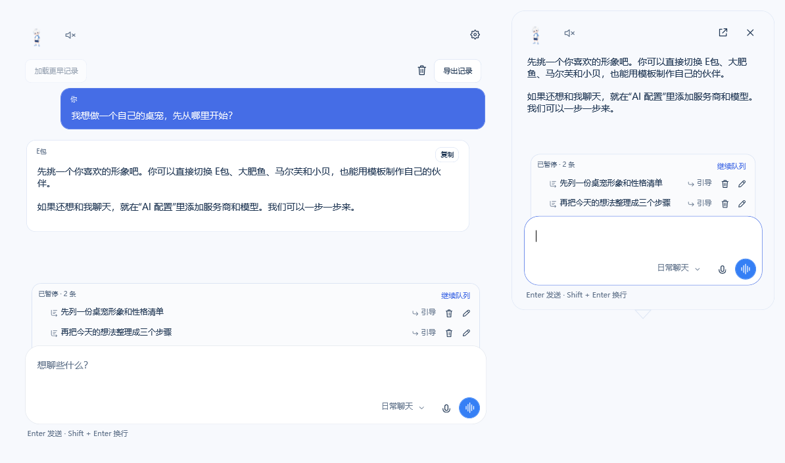
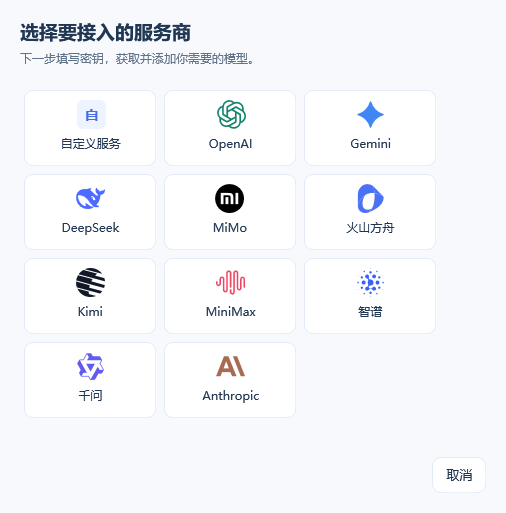
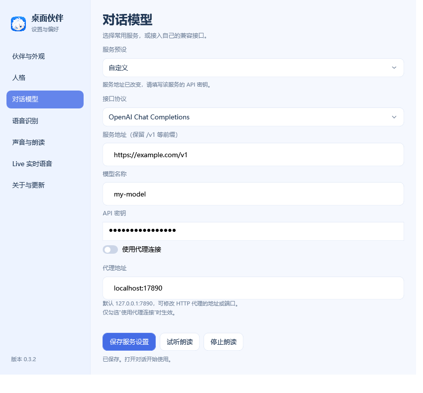
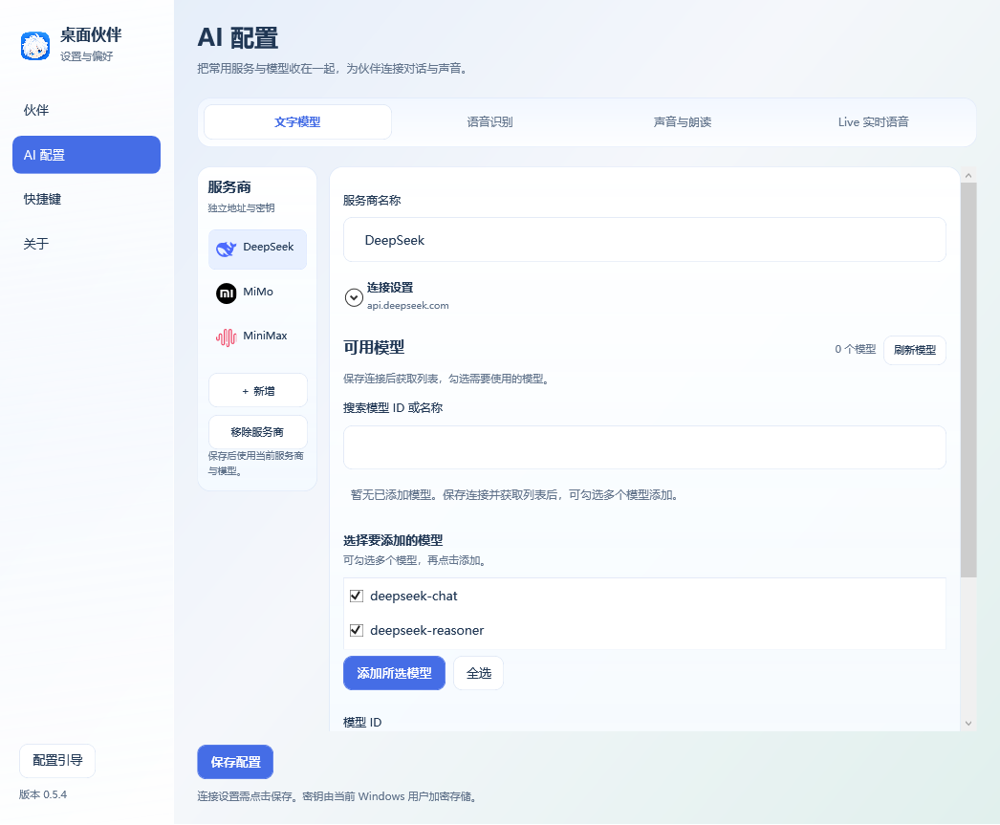
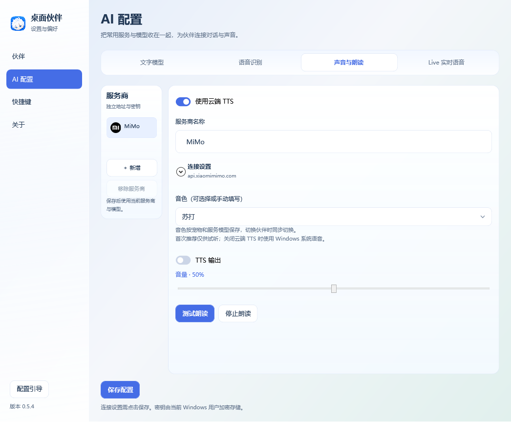
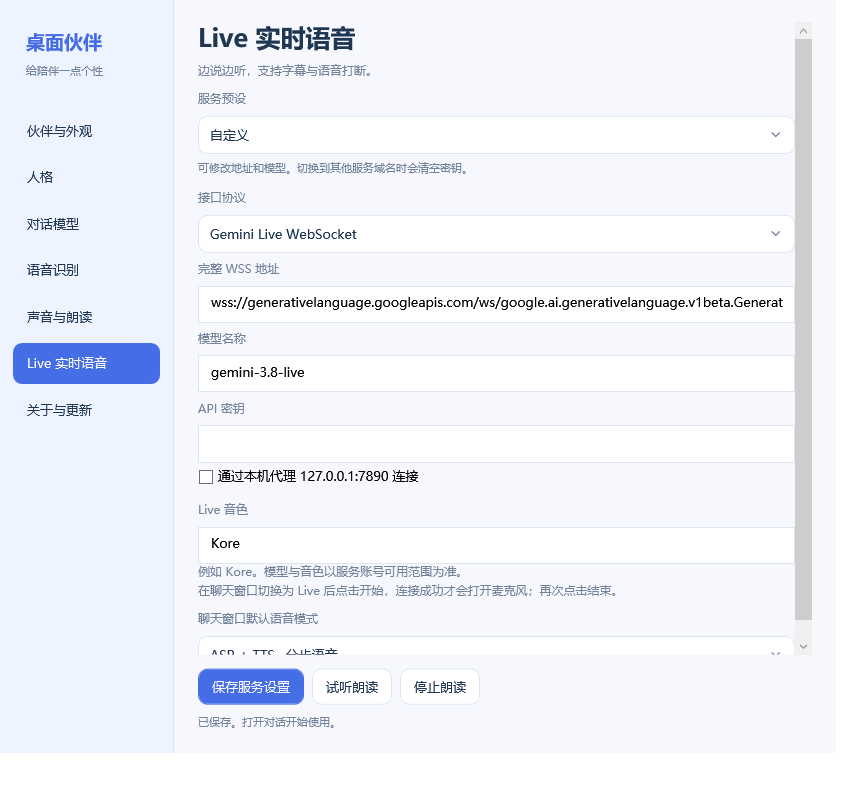
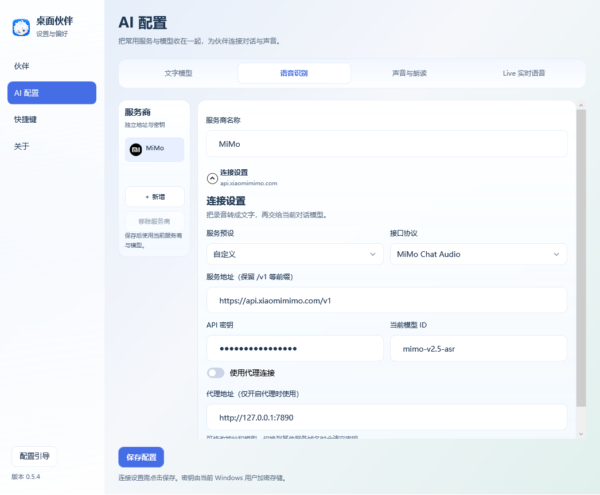

  
  <h1>桌面伙伴 · DeskPet</h1>
  
四位桌面伙伴，陪你工作，也陪你闲聊。

  
原画动作与互动 · 多服务商 AI 对话 · 听写、朗读与 Live

  
<a href="https://github.com/Eason4869/deskpet/releases/latest">下载 Windows 版</a> · <a href="#开始使用">开始使用</a> · <a href="docs/dialogue-setup.md">模型配置指南</a> · <a href="CHANGELOG.md">更新日志</a>

  
当前开发版本 <a href="https://github.com/Eason4869/deskpet/tree/v0.6.0">0.6.0</a> · 最新公开 Release <a href="https://github.com/Eason4869/deskpet/releases/tag/v0.5.6">0.5.6</a> · Windows 10/11 x64

> 0.6.0 是基于 Windows 0.5.6 完整功能的开发标签，新增 macOS 适配与明确区分平台、CPU 的包名。该版只提供代码与 tag，**不创建 GitHub Release、不公开分发 Mac 安装包**；公开下载仍为 Windows 0.5.6。Mac 两架构已通过真实原生、UI 与预览打包 CI，完整功能及人工设备验收边界见 [Mac 就绪矩阵](docs/macos-readiness-0.6.0.md)。

> **升级过渡：0.5.4 及更早正式版本的安装版，无法直接通过内置更新升级到 0.6.0 及后续版本。**请先手动安装 0.5.6，再使用内置更新；也可直接手动安装最新版。覆盖安装会保留原有 `data` 数据。0.5.6 沿用旧安装包名称，并已加入下一版规范名称的识别。便携 ZIP 名称保持兼容，不受本次安装包改名限制。

## 选一位伙伴

无需配置 AI，就能把伙伴放在桌面上：看向鼠标、偶尔散步，接受摸头和投喂，也会打招呼、跳跃和小憩。

<table>
  <tr><th>E包</th><th>大肥鱼</th><th>马尔芙</th><th>小贝</th></tr>
  <tr>
    <td align="center"></td>
    <td align="center"></td>
    <td align="center"></td>
    <td align="center"></td>
  </tr>
  <tr><td align="center">傲娇毒舌的白发正太</td><td align="center">温和俏皮的鲸鱼娘</td><td align="center">聪明俏皮的魔法少女</td><td align="center">机灵温柔的科技少年</td></tr>
</table>

首次启动默认 E包。四位伙伴各有独立的人格、聊天记录、待发送队列与音色偏好。你可以编辑人格，为每位伙伴选择不同的声音，或导入自己制作的外观。

## 看看能做什么

### 随时聊两句，也能把想法慢慢展开

双击伙伴打开头顶快速对话，点展开图标进入完整聊天。两个窗口共享会话，支持流式回复、停止生成、历史记录与 Markdown 导出。

回复还没结束时，也可以继续发送：消息进入队列，按顺序处理。拖动六点柄调整顺序，还能编辑、删除，或用“引导”优先处理新要求。停止或出错后队列暂停，重启后可手动继续。

### 打个招呼，或直接开口说

中键技能轮盘分为四格：喂零食、小憩和两项具名招牌动作；中心可切换基础动作。想开口聊天时，可以选择“听写 → 文字回复 → 朗读”，或使用 Gemini Live 连续通话。

<table>
  <tr><th>桌面互动</th><th>Live 实时语音</th></tr>
  <tr>
    <td align="center"></td>
    <td align="center"></td>
  </tr>
</table>

*四格轮盘截图来自 0.5.6；其余未改变的界面沿用 0.5.4 实际截图。对话内容、候选模型与通话状态使用演示数据。*

| 伙伴 | 招牌动作一 | 招牌动作二 |
| --- | --- | --- |
| E包 | 傲娇扭头 | 比心鼓励 |
| 大肥鱼 | 摇尾欢呼 | 泡泡环游 |
| 马尔芙 | 挥杖流光 | 荧光咒语 |
| 小贝 | 太极光环 | 全息键盘 |

喂零食、小憩和两项招牌每次随机播放新旧两套中的一套；旧坐姿小憩与新站姿同时保留。拎起和落地使用同一套版本，普通落地与踉跄共用向下位移。动作保持 8 FPS，不混帧、不追赶跳帧。

## 开始使用

1. **下载安装。**在 [Release](https://github.com/Eason4869/deskpet/releases/tag/v0.5.6) 下载 `DeskPet-Setup-0.5.6.exe`，按中文向导安装，无需管理员权限。免安装版下载 `DeskPet-Windows-0.5.6.zip`，完整解压后运行“桌面伙伴.exe”。
2. **认识伙伴。**首次启动会打开 16 步配置引导，带你切换伙伴、编辑人格、拖动和互动，再配置可选的 AI 与语音服务。
3. **按需接入 AI。**只想使用桌宠可以跳过模型与语音步骤；想聊天时，按下方流程添加服务商和模型。

Windows 公开版需要 .NET Framework 4.8，无需安装 Node.js。当前公开下载仅有 Windows 0.5.6；macOS 0.6.0 为开发标签和可构建预览，没有公开 Release。

### macOS 开发标签 0.6.0

Mac 使用 Avalonia / .NET 10，复用 0.5.6 的模型、对话、队列、语音与伙伴业务；提供菜单栏、快速与完整聊天、设置、使用引导、Live 和关于与更新窗口。Mac 设置中的文字、听写、云朗读、Live 和语音分别配置，窗口布局与下面的 Windows 截图不同。0.5.6 升级到 0.6.0 属于新版本系列，会自动打开一次新版引导。

可在 macOS 14+ 上按 [Mac 构建说明](installer/macos/README.md) 分别构建 Apple Silicon 与 Intel 自包含预览，无需 Docker。产物名为 `DeskPet-macOS-0.6.0-arm64-preview.dmg` / `.zip` 或 `DeskPet-macOS-0.6.0-x86_64-preview.dmg` / `.zip`，仅做 ad-hoc 签名，**未经 Apple Developer ID 签名或公证**。真实麦克风授权、实际听感、多屏与登录重启仍需人工验收；Windows DPAPI 密钥需要在 Mac 重新录入。

Mac“关于与更新”只启用本机平台与 CPU 的规范附件；当前公开 Release 没有 Mac 包时，下载按钮保持禁用。Windows 更新也只识别规范 Windows 包。未来 0.6.0 Windows 构建名为 `DeskPet-Windows-Setup-0.6.0.exe` 和 `DeskPet-Windows-0.6.0.zip`，命名与兼容规则见 [发布包命名说明](docs/release-naming.md)。

### 配置引导就在真实设置页里

每一步只开放当前需要的区域。文字模型步骤支持完整的厂商选择、获取列表和多选添加；实际添加并选中模型后，“下一步”才会启用，并保存当前页。

“跳过这一步”进入下一项，“跳过引导”结束整个流程。首次启动或进入更高的主／次版本系列（如 0.5 → 0.6、0.8 → 1.0）会自动打开；同系列补丁升级（如 0.5.3 → 0.5.11）不会。完成、跳过或关闭后，同系列不再自动弹出，降级不回退已记录系列。仍可从设置左下角的“配置引导”手动重开。引导期间暂停朗读与 Live 测试。

## 接入模型与语音

右键伙伴打开“设置”，进入 **AI 配置**。文字、语音识别、声音与朗读、Live 各自管理服务商，分别保存地址、Key 和代理；切换页面会保留未保存的填写内容。

### 文字模型：先选厂商，再添加模型

1. 点击 **新增**，选择 DeepSeek、MiMo、MiniMax 等厂商，或选择自定义接口。
2. 确认服务地址，填入自己的 **API Key**，点击 **保存并获取模型列表**。
3. 勾选一个或多个模型，点击 **添加所选模型**，选中要使用的模型，最后点击 **保存配置**。

已保存且配置有效的文字服务，在进入页面后可自动获取候选列表，也可手动刷新。支持按模型 ID／中文名搜索；获取失败保留已添加模型，仍可手填 ID 和中文别名。候选列表不会自动全部加入配置。

查看多选添加模型的界面

支持 **OpenAI Chat Completions** 与 **Anthropic** 文字协议。输入框右下角可按服务商切换已配置模型，悬停查看真实 ID；切换从下一条请求生效。模型是否支持文字对话，以服务商能力与账号权限为准。

### 语音服务：预填模型，分别测试

| 页面 | 配置方式 | 使用入口 |
| --- | --- | --- |
| 语音识别 | 选厂商后预填可编辑的模型名，填写独立 Key | 输入框的麦克风按钮 |
| 声音与朗读 | Windows 系统语音，或云端 TTS、音色与音量 | 本页“测试朗读”；对话头像旁的喇叭开关 |
| Live 实时语音 | Gemini Live、独立 Key 与 Live 音色 | 本页“测试 Live 通话”；输入框空闲且为空时的通话按钮 |

<table>
  <tr><th>声音与朗读</th><th>Live 实时语音</th></tr>
  <tr>
    <td></td>
    <td></td>
  </tr>
</table>

语音页直接使用可编辑的模型名，不获取模型列表。TTS 与 Live 音色按伙伴和服务模型分别保存，支持下拉选择和手填 Voice ID。音量默认 50%，修改后立即生效并保存。

查看语音识别的配置界面

听写时，停止按钮将识别结果填入草稿，发送按钮识别后发送或排队。Live 连接成功后才打开麦克风，挂断或关闭窗口会停止收音并返回原页面。两种语音方式的配置与测试相互独立。

详细步骤见 [对话与语音配置](docs/dialogue-setup.md) · [音色预设](docs/voice-presets.md)。

## 日常陪伴与操作

| 操作 | 会发生什么 |
| --- | --- |
| 拖动伙伴，再松开 | 新旧拎起／落地成对随机；40% 概率踉跄，10 秒冷却 |
| 单击头部／身体 | 摸摸头／戳一戳 |
| 鼠标移入伙伴 | 空闲时随机跳跃、打招呼或两项招牌动作之一；一次移入只触发一次 |
| 鼠标中键 | 打开动作轮盘，悬停后选择技能或动作 |
| 双击伙伴 | 打开快速对话；Enter 发送，Shift + Enter 换行 |
| 右键伙伴 | 互动、切换外观，或进入设置 |
| 托盘图标 | 显示／隐藏伙伴、暂停、关闭鼠标穿透或退出 |

**安静地陪着你。**免打扰会暂停问候、散步和自动朗读；默认在伙伴所在屏幕全屏时隐藏。鼠标穿透让点击落到下方应用，锁定位置可禁止拖动和散步。自启默认关闭，可在“伙伴 → 陪伴方式”开启。

**偶尔主动打个招呼。**默认每 30–60 分钟显示一条角色预设问候，不消耗模型额度。可关闭或调整间隔；开启“使用 AI 生成主动问候”后，会结合当前伙伴最近的聊天生成，失败时回退预设。问候不自动朗读，也不加入历史。

**空闲时小憩。**系统空闲 5 分钟或 15 分钟未操作伙伴后，每分钟有 70% 概率小憩；聊天、拖动、设置和引导期间不会触发。偶尔散步的等待间隔为 90～180 秒，互动后重新计时。两项都可在“陪伴方式”关闭。

默认快捷键、聊天记录与数据

| 快捷键 | 功能 |
| --- | --- |
| Ctrl + Alt + Space | 唤出快速对话 |
| Ctrl + Alt + H | 显示／隐藏伙伴 |
| Ctrl + Alt + D | 开关免打扰 |
| Ctrl + Alt + P | 开关整体鼠标穿透 |

快捷键可在设置中编辑或禁用，冲突时会提示。聊天记录默认按伙伴保存，最多最近 200 轮／8 MiB，以先到的上限为准。配置、密钥、记录和导入外观保存在程序旁的 `data`；密钥与本机聊天记录使用当前 Windows 用户加密。导出的 Markdown 为普通可读文件，可自行备份 `data`。

启动不会发起 AI 对话或打开麦克风；进入已有效配置的文字模型页面时会请求模型列表。使用云端 AI 或语音时，相应内容会发送给你选择的服务商。

更多操作见 [日常使用](docs/daily-use.md)。升级可在“设置 → 关于”检查并更新，自动校验下载内容并在空闲时安装；重启前可取消。安装包暂未签名，发布页提供 SHA256。详见 [安装、升级与备份](docs/installation.md) · [发布包命名与兼容](docs/release-naming.md)。

## 制作自己的桌宠

在 [Release](https://github.com/Eason4869/deskpet/releases/tag/v0.5.6) 下载四位伙伴的高清外观包，解压后在“伙伴与人格”页导入 `pet.json`。也可下载 `DeskPet-Skin-Template-v2-0.5.6.zip`，从完整创作模板开始。独立外观包遵循通用导入协议，内置伙伴新增的第二招牌与新旧随机互动由程序自带。

- **v1**：8 列 × 11 行透明 PNG，高清模板为 3840 × 5720，单帧 480 × 520。
- **v2**：按动作分别绘制 PNG，自定义帧数、播放速率和循环；提供 17 组动作与 16 方向注视模板。
- 在 `pet.json` 填写角色名称、简介、人格和专属动作名称，随外观一起导入。

详见 [外观格式](docs/skin-format.md) · [模板说明](templates/README.md)。

## 接下来的计划

- [ ] macOS 版本（独立推进，计划 0.6.0）。
- [ ] 每位伙伴独立的好感度与互动反馈。
- [x] 四宠拖动放下后的概率踉跄、四格技能及新旧随机互动。
- [ ] 节日限定服饰与动作。

未勾选项目尚未完成，具体规则见 [开发路线图](docs/roadmap.md)。

---

作者：**彧晟Eason** · [反馈问题](https://github.com/Eason4869/deskpet/issues) · [素材与协议来源](docs/sources.md)
