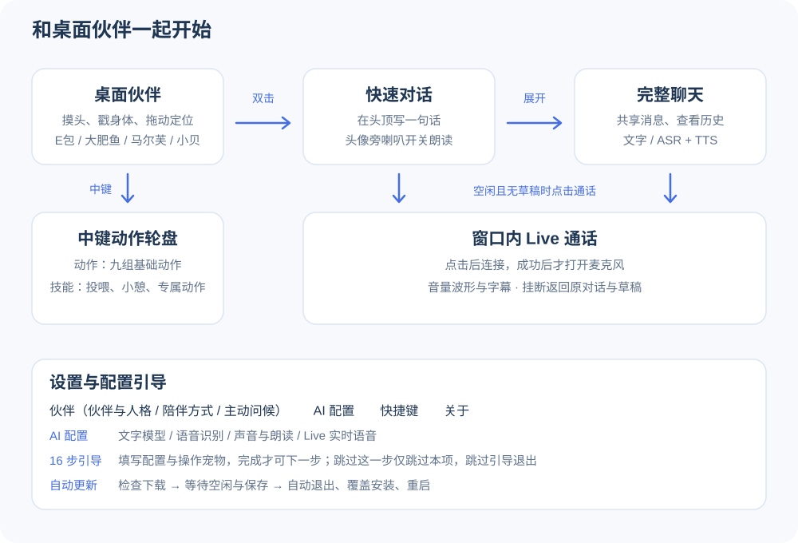
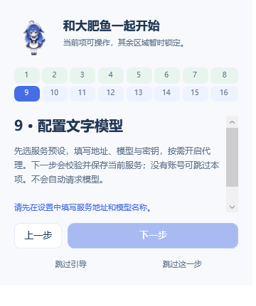
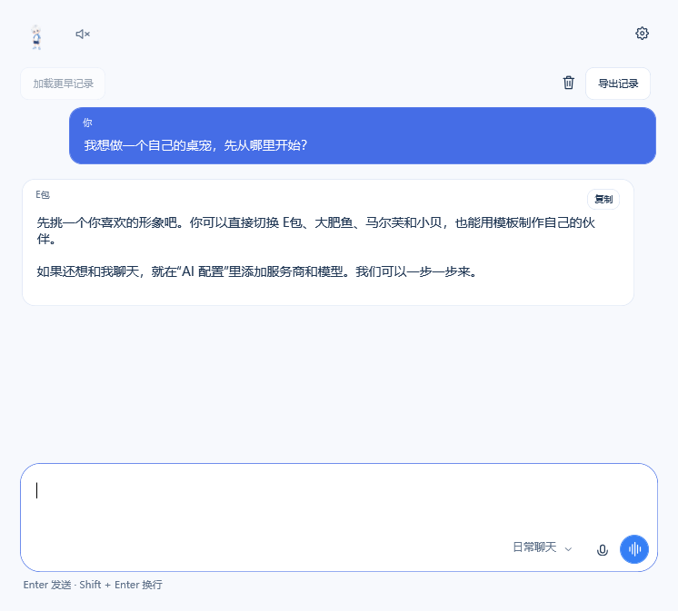
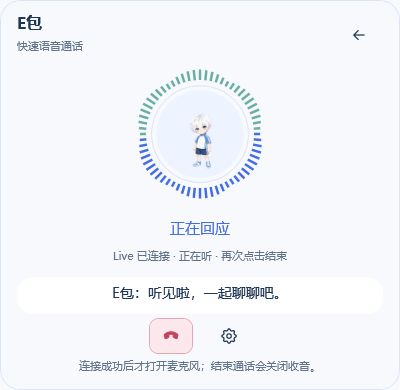



  
  <h1>桌面伙伴 · DeskPet</h1>
  
把 E包放在桌面，偶尔问候，随时聊代码、设计和想法。

  
<a href="https://github.com/Eason4869/deskpet/releases/latest">下载安装包</a> · <a href="CHANGELOG.md">更新日志</a> · <a href="https://github.com/Eason4869/deskpet/issues">反馈问题</a>

  
Windows 10/11 x64 · .NET Framework 4.8 · 作者：彧晟Eason

**[0.5.4](https://github.com/Eason4869/deskpet/releases/tag/v0.5.4)** · 四位桌面伙伴、原画动画、带厂商标识的模型管理、文字模型列表自动获取、可拖动消息队列和可选 AI 主动问候。

## 安装

**Windows：**到 [0.5.4 发布页](https://github.com/Eason4869/deskpet/releases/tag/v0.5.4) 下载 **DeskPet-Setup-0.5.4.exe**，按中文向导安装，无需管理员权限。也可下载 **DeskPet-Windows-0.5.4.zip**，完整解压后运行 **桌面伙伴.exe**。需要 .NET Framework 4.8，不需要安装 Node.js。

当前支持 Windows。macOS 版本计划在后续版本提供，目前没有可下载的 Mac 安装包。
首次启动默认 **E包**，还可切换 **大肥鱼**、**马尔芙**（金发绿眼的魔法少女）和 **小贝**（黑白机能服科技少年，专属动作“太极光环”）。已有用户保留原先选择；无需接入 AI 就能使用桌宠。

<table>
  <tr><th>E包</th><th>大肥鱼</th><th>马尔芙</th><th>小贝</th></tr>
  <tr>
    <td align="center"></td>
    <td align="center"></td>
    <td align="center"></td>
    <td align="center"></td>
  </tr>
  <tr><td align="center">傲娇毒舌 · 白发正太</td><td align="center">温和俏皮 · 蓝白鲸鱼娘</td><td align="center">聪明俏皮 · 魔法少女</td><td align="center">机灵温柔 · 科技少年</td></tr>
</table>

四位伙伴拥有各自的人格、音色偏好和独立聊天记录。你可以编辑人格，为每位伙伴分别选择 TTS 和 Live 声音。

<table>
  <tr><td align="center"></td><td align="center"></td><td align="center"></td></tr>
</table>

## 使用

首次启动提供 16 步引导：伙伴、人格、陪伴方式、拖动、右键菜单、中键轮盘、单击互动、双击快速对话、文字模型、语音识别、回复朗读、Live、主动问候、快捷键、对话与队列、更新与网络加速。仅当前项可操作，其余区域灰显锁定；必填项未完成或实操未达成时，“下一步”不可点击。桌面实操期间暂时收起设置，避免遮挡宠物。

“跳过这一步”只跳过当前项并进入下一步，未保存草稿留在设置页；“跳过引导”或关闭引导结束整个流程并恢复正常操作。设置左下方“配置引导”可重新开始；已有配置升级后不会自动弹出。

添加文字模型时，引导会开放完整的厂商选择、列表获取与模型添加区域；先添加并选择模型，再点引导的“下一步”保存当前页。语音页选择厂商后确认预填模型并填写独立 Key。引导期间暂停朗读与 Live 测试，完成或退出后可在对应页面测试。

| 操作 | 功能 |
| --- | --- |
| 左键拖动角色 | 拎起伙伴移动，松开后落地 |
| 单击头部 / 身体 | 摸摸头 / 戳一戳 |
| 鼠标移入角色 | 空闲时跳跃一次，悬停期间暂停视线跟随；移开后恢复 |
| 鼠标中键点击角色 | 以当前光标为中心打开动作轮盘；图片下方有短标签，悬停可看说明 |
| 动作轮盘 → 技能 | 喂零食、小憩／叫醒、专属动作 |
| 动作轮盘 → 动作 | 待机、左右跑、招呼、跳跃、委屈、等待、思考、检查成果 |
| 右键 → 互动 | 摸摸头、戳一戳、喂零食、小憩或叫醒、专属动作 |
| 双击角色 | 打开头顶快速对话；Enter 发送，Shift + Enter 换行 |
| 气泡中点击展开图标 | 收起快速对话并打开完整对话，共享当前伙伴的会话 |
| 左上角缩略图旁的喇叭图标 | 开关 TTS 自动朗读；快速对话、完整聊天和设置同步，关闭立即停止朗读 |
| 输入框空闲且为空时的声波“通话”按钮 | 在当前窗口内显示通话界面，连接后显示字幕与随真实声音变化的波形 |
| 右键 → 外观 / 设置 | 直接切换伙伴 / 打开详细设置 |
| 设置 → 伙伴 → 伙伴与人格 | 切换形象和对应人格，导入自己的桌宠 |
| 设置 → 伙伴 → 陪伴方式 | 调节大小、散步、置顶、开启自启（默认关闭） |
| 设置 → 伙伴 → 主动问候 | 默认每 30–60 分钟打招呼，可关闭、调节时间及预览；气泡 12 秒后收起 |
| 右键菜单外点击空白 | 立即关闭菜单 |
| 完整聊天 → 加载更早记录 / 导出记录 | 每次加载 50 轮；导出当前伙伴的 Markdown 记录 |
| 设置 → 快捷键 | 保存历史、免打扰、全屏隐藏、鼠标穿透、锁定位置与自定义快捷键 |
| 托盘“显示 / 隐藏伙伴” | 控制手动显示意愿；退出全屏不会恢复手动隐藏的角色 |
| 设置 → 关于 | 启动自动检查或手动“检查并更新”，下载校验后空闲时自动安装、重启；支持取消 |
| 关于 → 网络加速 | 默认收起；选择直连、测试后选用 GitHub 镜像，或填写网络代理 |
| 关于 → 卸载 | 打开卸载向导，保留本机设置和聊天数据 |

*对话界面示意，回复内容为演示示例。*

## 历史、流式与免打扰

- **历史保存**：默认开启，每位伙伴最近 200 轮／8 MiB，上限先到者生效。保存在 `data/history`，使用当前 Windows 用户加密；重启后恢复。关闭保存不删除已有记录，清空删除当前伙伴的磁盘和内存记录。导出 Markdown 是可阅读的普通文件。
- **流式回复**：对话模型设置中默认开启，快速气泡与完整聊天同步显示。接口不支持时可关闭；停止／断线保留已输出内容并标注状态，未完成轮次不作为下次完整上下文。TTS 在文字完成后朗读。
- **排队与引导**：忙碌时发送默认排队，逐条回复；悬停队列行显示六点拖拽柄，拖动可改变待发送顺序；列表还可引导、删除和编辑，正在回复的消息不参与排序。“引导”会打断当前回复，优先处理新要求，再继续队列。停止或出错后暂停；本机保存未发送内容，重启后手动继续。详见[日常使用](docs/daily-use.md)。
- **免打扰**：暂停主动问候、散步和自动朗读，保留 TTS 偏好；主动聊天与 Live 仍可使用。
- **全屏隐藏**：默认开启，仅检测角色所在屏幕。主动唤出快速聊天可临时显示，手动隐藏不会被自动恢复。
- **鼠标穿透与锁定**：穿透让角色区域的点击落到下方应用，托盘可关闭；锁定禁止拖动和散步。

| 默认快捷键 | 功能 |
| --- | --- |
| Ctrl + Alt + Space | 唤出快速对话 |
| Ctrl + Alt + H | 显示／隐藏伙伴 |
| Ctrl + Alt + D | 开关免打扰 |
| Ctrl + Alt + P | 开关整体鼠标穿透 |

快捷键可编辑或禁用；注册冲突会提示，托盘入口始终可用。详见 [日常使用](docs/daily-use.md)。

## 配置 AI 与语音

设置左侧集中为 **伙伴、AI 配置、快捷键、关于**。进入 **AI 配置**，再选择 **文字模型、语音识别、声音与朗读、Live 实时语音**；“伙伴”内分为 **伙伴与人格、陪伴方式、主动问候**；切换二级页签会保留未保存的填写内容。

TTS 和 Live 音色提供可编辑下拉框，按厂商及模型显示 Voice ID 与简短说明，也可手动填写。音色按**伙伴和服务模型**分别保存：切换角色会恢复它的声音，切换服务后也会恢复该服务的选择。见[音色预设说明](docs/voice-presets.md)。

文字模型可添加多个服务商，分别保存地址、密钥和模型列表。常见服务商显示对应 Logo，名称默认使用 DeepSeek、MiMo、MiniMax 等厂商名；手动填写的名称会保留。新增时先选择厂商，填入 Key 后点击“保存并获取模型列表”；勾选需要的多个模型并点击“添加所选模型”，最后保存配置。已保存服务商进入配置页后可自动获取候选列表，也可手动刷新；仅把你选择的模型加入配置。可按模型 ID 或中文名称搜索，当前选择带有标记。获取失败保留原列表，支持手动添加与中文显示名。连接区可展开编辑，切换服务商保留草稿。

语音识别、朗读和 Live 使用相同的厂商侧栏与 Logo，但选择厂商后直接预填可编辑的模型名，不获取模型列表。各服务独立保存地址、Key 和代理。“测试朗读”位于朗读页，测试 TTS 或 Windows 系统语音；“测试 Live 通话”位于 Live 页，使用 Live 模型与音色，连接成功后才收音，挂断返回设置。

输入框右下角的模型菜单按服务商分组，悬停可查看真实模型 ID；切换从下一条请求生效，不改变正在进行的回复。支持 **OpenAI** 与 **Anthropic** 文字协议；内置 OpenAI、Gemini、DeepSeek、MiMo、火山、Kimi、MiniMax、智谱、千问等填表示例。模型列表接口返回的可见模型不保证全部兼容文字对话，实际权限与能力以服务商为准。

- **听写 + TTS**：右侧麦克风开启听写；停止图标识别后填入草稿，黑底箭头识别后发送或排队。文字完成后按 TTS 偏好朗读。支持 MiMo / OpenAI 音频接口，也可使用 Windows 系统朗读。
- **Gemini Live**：配置 Live 服务后，清空输入框并等待 AI 空闲后，点击右侧声波“通话”按钮，在原窗口内覆盖显示通话界面。窗口会开始连接，成功后才打开麦克风；环形波形随实际收音与回复音量变化，同时显示字幕。点击挂断、返回文字对话或关闭通话窗口可结束。TTS 喇叭控制分步朗读，Live 音频随通话输出。
- 每项服务有独立代理开关，默认地址 **http://127.0.0.1:7890**，可编辑。音量默认 **50%**，立即生效并保存。

启动不会发起 AI 对话或打开麦克风。仅进入文字模型配置页且连接信息有效时，会向当前服务商获取模型列表；其他语音配置页不获取列表。密钥使用当前 Windows 用户加密，配置与导入外观保存在程序旁的 `data`。真实模型权限、网络可达性和声音质量由所用服务决定；安装包暂未签名。

主动问候默认使用角色预设台词，不消耗模型额度。可在“伙伴 → 主动问候”开启“使用 AI 生成主动问候”，使用当前文字模型和当前伙伴最近聊天；失败、超时或未配置时回退预设。问候不自动朗读，也不加入聊天历史。聊天、语音、互动、小憩、全屏、暂停或隐藏期间保持安静；短暂忙碌结束后延后再尝试，明确暂停、免打扰或关闭功能后重新计时。自动更新保留 `data`；手动检查会自动下载、校验、退出、覆盖安装并重启，无需手动退出桌宠。正在对话、语音、输入文字、尚未保存设置或聊天记录保存失败时先等待。重启前显示 5 秒倒计时气泡，可直接取消。更新仅检查正式发布版本。

详见 [对话配置](docs/dialogue-setup.md)。

## TODO

以下为待开发需求；标注 **[待确认]** 的部分需要进一步设计，不代表当前版本已支持。

### 好感度系统

- [ ] 设计每位伙伴独立的好感度系统，让日常陪伴和互动形成持续反馈。
- [ ] **[待确认] 呈现方式**：使用数值、关系阶段、表情／动作或台词变化；是否向用户直接展示好感度。
- [ ] **[待确认] 运行模式**：抚摸、投喂、聊天、陪伴时长等行为是否影响好感度，以及增长上限、冷却、是否衰减和长期未使用时的处理方式。
- [ ] **[待确认] 反馈与保存**：不同阶段是否解锁专属台词或动作；明确本地保存、切换伙伴、重启及重置规则。

### 拖动放下后的概率踉跄

- [ ] 在现有“拎起 → 放下”交互中加入概率触发的踉跄动作，表现为落地后短暂站不稳，再恢复正常状态。
- [ ] 仅在实际拖动并松开后判定，普通点击不触发；处理连续拖动、动作被打断和暂停等情况，避免卡住或重复播放。
- [ ] **[待确认] 触发规则**：固定概率还是与拖动距离／速度关联，以及触发冷却和是否提供开关。
- [ ] 为内置伙伴补充适配动作；自定义外观缺少踉跄素材时回退到普通落地动作。

### 节日限定服饰与动作

- [ ] 在特殊节日当天解锁对应服饰和动作，并提供节日提示与选择入口。
- [ ] **中秋节**：制作／赠送赛博月饼的互动与动作。
- [ ] **端午节**：制作／赠送赛博粽子的互动与动作。
- [ ] **万圣节**：节日新衣与配套动作。
- [ ] 支持公历节日与农历节日识别，明确按本地日期判定；覆盖跨日运行和节日当天重新启动的情况。
- [ ] **[待确认] 解锁规则**：是否必须当天启动或互动领取，解锁后永久保留还是仅当天可用，错过后是否支持次年再次获取。
- [ ] 分别适配各伙伴的节日素材；自定义外观缺少素材时保留原外观和基础动作。

建议推进顺序：先完成拖动踉跄，再确定好感度方案；节日功能按“日期识别与解锁规则 → 单个节日试做 → 扩充素材”逐步推进。

## 自定义外观

四位伙伴的高清外观包可从 [0.5.4 发布页](https://github.com/Eason4869/deskpet/releases/tag/v0.5.4) 下载，在设置中导入解压后的 `pet.json`。制作自己的桌宠可从 **templates/pet.json** 开始；模板、Schema 和动作网格图都在仓库 **templates** 文件夹。完整 v2 创作模板位于 **templates/high-fps-v2/**，也可单独下载 **DeskPet-Skin-Template-v2-0.5.4.zip**。

四位预设伙伴拥有九组基础动作与 **16 个视线方向**，可以打招呼、跳跃、散步和跟随鼠标看向不同方向，还能被拎起、接受抚摸与投喂、小憩，并展示各自的专属动作。互动无需连接 AI。 预设伙伴使用低帧率原画直接换帧，不做帧间混合；鼠标停止约 1.4 秒后回到待机，再次移动时恢复看向鼠标。

自定义外观支持 **8 列 × 11 行**透明 PNG 的 v1 格式，也支持逐动作 PNG 的 v2 格式。v1 高清模板为 3840×5720，单帧 480×520；v2 可单独设置帧数、播放速率和循环。还可在 `pet.json` 中填写名称、简介和人格，切换形象时一并切换。高帧率作者模板保留供创作使用，当前预设伙伴使用低帧原画动画。

详见 [外观格式](docs/skin-format.md) 和 [模板说明](templates/README.md)。

[安装与升级说明](docs/installation.md) · [素材与协议来源](docs/sources.md)
