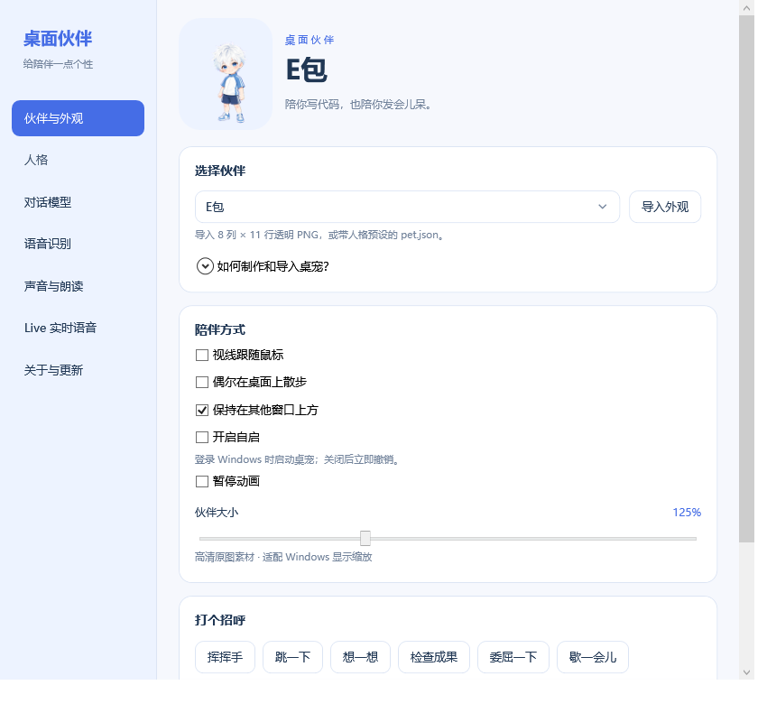
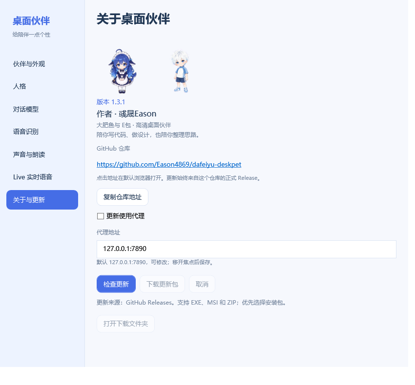

<div align="center">
  
  
  <h1>大肥鱼 · Windows 桌面伙伴</h1>
  <p>高清小伙伴，陪你写代码、做设计，也陪你发会儿呆。</p>
  <p><b>大肥鱼与 E包 · 独立人格 · 头顶对话 · 文字与语音 · Gemini Live</b></p>
  <p><a href="https://github.com/Eason4869/dafeiyu-deskpet/releases/latest">下载最新版本</a> · <a href="CHANGELOG.md">更新日志</a> · <a href="docs/skin-format.md">制作桌宠</a> · <a href="https://github.com/Eason4869/dafeiyu-deskpet/issues">反馈问题</a></p>
  <p>Windows 10/11 x64 · .NET Framework 4.8 · 作者：<a href="https://github.com/Eason4869">彧晟Eason</a></p>
</div>

## 先把伙伴放到桌面

从 [Releases](https://github.com/Eason4869/dafeiyu-deskpet/releases/latest) 下载 **DafeiyuDeskPet-Setup-1.3.1.exe**，按中文向导安装。默认安装到当前用户的 `%LOCALAPPDATA%\Programs\DafeiyuDeskPet`，无需管理员权限；开始菜单可启动和卸载，也可选择桌面快捷方式。

喜欢免安装版，可下载 **大肥鱼桌宠-Windows.zip**，完整解压后运行 **大肥鱼桌宠.exe**。程序旁的 `data` 保存个人配置和导入外观；不要把程序放在无法写入的文件夹。

安装后无需配置模型就能使用桌宠。联网对话由你填写服务和密钥后手动发起，启动和自启不会打开麦克风或请求模型。

| 想做什么 | 操作 |
| --- | --- |
| 移动伙伴 | 左键拖动 |
| 打招呼 | 单击角色；更多动作在右键菜单 |
| 快速说一句 | 双击角色，打开头顶气泡；Enter 发送 |
| 查看完整对话 | 气泡里点“展开聊天”，或右键“打开完整对话” |
| 更换伙伴和人格 | 设置 → 伙伴与外观 / 人格 |
| 登录时启动 | 设置 → 伙伴与外观 → 开启自启，默认关闭 |
| 找回隐藏的伙伴 | 托盘“显示 / 隐藏伙伴”；勾选表示显示 |
| 更新程序 | 设置 → 关于与更新 → 检查更新 |

再次运行程序会打开已有实例的设置窗口。双击气泡外的角色不会启动多个实例。

## 每位伙伴都有自己的性格

大肥鱼是温和俏皮的蓝白鲸鱼娘；E包是傲娇、毒舌的白发正太。切换外观同步切换人格和记录；每位伙伴最近 10 轮成功会话分别保存在内存，退出程序后不保留。

两套外观各有 **73 帧**、九组动作及十六个视线方向。每帧 **480×520**，完整透明图 **3840×5720**；使用高清原图，适配 Windows 显示缩放。可调大小、置顶、视线跟随和散步。



人格页可编辑当前伙伴，或恢复其模板预设。保存人格会清空该伙伴的当前会话；对话或 Live 进行时先停止再切换。

## 想聊的时候再接入模型

设置 → **对话模型**，选择服务预设或手动填写地址、模型与密钥，再点“保存服务设置”。支持 **OpenAI Chat Completions** 和 **Anthropic Messages**。模型、ASR、TTS 与 Live 各有代理开关和可编辑地址，默认 `127.0.0.1:7890`；修改地址后保存即可，关闭开关时直接连接。

预设包括 OpenAI/ChatGPT、Gemini、DeepSeek、MiMo、火山、Kimi、MiniMax、智谱、千问与 Claude。预设提供填表示例，实际可用模型和权限以你的账号为准；每项服务可独立选择本机 HTTP 代理 **127.0.0.1:7890**。

| 方式 | 怎么用 |
| --- | --- |
| 文字聊天 | Enter 发送，Shift + Enter 换行；支持停止、复制、清空 |
| 头顶气泡 | 随角色移动，限制在屏幕内；与完整聊天共享当前伙伴会话 |
| ASR + TTS | 点击说话 → 结束并发送 → 识别 → 模型回复 → 朗读；最长 60 秒 |
| Gemini Live | 单独配置 Live 服务 → 开始 Live；持续双向语音、字幕与打断；再次点击结束 |


*界面示例中的回复来自本地模拟接口，用于展示真实控件与交互。*

ASR 与 TTS 可分别配置，或复用文字服务的地址、密钥和代理。支持 MiMo Chat Audio / OpenAI Audio；也可直接使用 Windows 系统语音。音量默认 50%，调节立即生效并保存；朗读失败仍保留文字。

密钥使用当前 Windows 用户 DPAPI 加密保存。修改服务域名、协议或端口会清除原密钥；同一服务内改地址路径可保留。桌宠不会自动读取文件或看见你的桌面；你发送的文字和录音交给所配置的服务。

详细步骤、接口要求与故障排查见 [对话与语音配置](docs/dialogue-setup.md)。

## 把自己的设计变成桌宠

设置 → **伙伴与外观** → 展开 **如何制作和导入桌宠**，打开随程序提供的模板文件夹。

1. 复制 `templates/pet.json` 和透明 PNG 示例。
2. 按 **8 列 × 11 行**动作网格制作精灵图，推荐每格 480×520。
3. 在 JSON 填写 `name`、`atlas` 和 `system_prompt`，指定外观及默认人格。
4. 将 JSON 与 PNG 放在一起，点“导入外观”选择 `pet.json`。

可直接导入符合格式的 PNG，再编辑人格。外观 ZIP 请先解压。参见 [完整教程](docs/skin-format.md)、[动作网格](templates/grid-guide.svg) 和 [JSON Schema](templates/pet.schema.json)。Release 还提供大肥鱼 / E包的高清外观包，均带对应人格。

## 更新、升级与个人数据

“关于与更新”中的仓库地址固定为 [Eason4869/dafeiyu-deskpet](https://github.com/Eason4869/dafeiyu-deskpet)，点击用默认浏览器打开，也可复制。更新有独立代理开关，代理地址默认 `127.0.0.1:7890`，可编辑并在移开焦点后保存。更新查询公开 GitHub Releases，优先下载 EXE/MSI 安装包，兼容 ZIP；显示进度、可取消，检查附件大小和 GitHub 提供的 SHA256 摘要。



下载后先从托盘退出桌宠，再运行安装包，选择原安装目录。**覆盖升级保留 data；卸载保留个人数据，并清理指向本安装位置的自启项。** 当前通过用户手动运行安装包完成更新。

首次从免安装版迁移，可在首次启动前把原 `data` 复制到新安装目录。换 Windows 用户或机器后，重新填写密钥。安装包目前未做应用代码签名，发布页提供 [SHA256 校验文件](https://github.com/Eason4869/dafeiyu-deskpet/releases/download/v1.3.1/SHA256.txt)。详情见 [安装、升级与自启](docs/installation.md)。

## 从源码构建

源码包含所需高清素材；在 Windows PowerShell 中运行：

```powershell
.\Build.ps1 -Target App
python .\Package.py
.\BuildInstaller.ps1 -Compiler "C:\Program Files (x86)\Inno Setup 6\ISCC.exe"
```

构建依赖 Windows 的 .NET Framework 4.8 编译器与 WPF、Python/Pillow，以及 Inno Setup 6.7 或更新版本。构建产物位于源码目录同级的 `outputs`，EXE 已嵌入两套外观。安装包编译成功后，`BuildInstaller.ps1` 自动刷新其 SHA256 清单条目。修改源码后按上述顺序重新构建全部产物。`PrepareAssets.py` 为原图导出的辅助脚本，普通构建不需要重新生成素材。

常规检查使用 `Build.ps1 -Target CoreTests`、`ProfileTests`、`ApiTests`、`ConversationTests`、`LiveTests`、`UpdateTests`、`StartupTests` 和 `ProxyTests`。本机界面及硬件验证另有 `ReleaseUiSmoke`、`ChatSmoke`、`UiSmoke`、`AudioSmoke`、`tests/NativeSmoke.py` 与 `tests/InstallerSmoke.py`；`tests/PackagingSmoke.py` 验证源码独立编译及打包，增加 `--compiler <ISCC.exe>` 可验证完整安装包与 SHA256 清单。硬件和安装检查请在独立测试环境执行。

## 验证与来源

已使用本机模拟 HTTP/WebSocket、真实 WPF 窗口与默认音频设备验证。真实在线 MiMo / Gemini 等账号的模型权限、网络与语音质量，需配置后确认；混合 DPI 多屏和设备热拔插尚未人工覆盖。完整证据见 [验证记录](docs/verification.md)。

角色与平台依据见 [素材与来源](docs/sources.md)。本项目当前未指定开源许可证；角色为生成式同人设计，使用或再发布素材时请阅读来源说明。

作者：**彧晟Eason**。问题与建议请提交 [Issue](https://github.com/Eason4869/dafeiyu-deskpet/issues)，附版本、服务类型和错误摘要，避免提供密钥。
