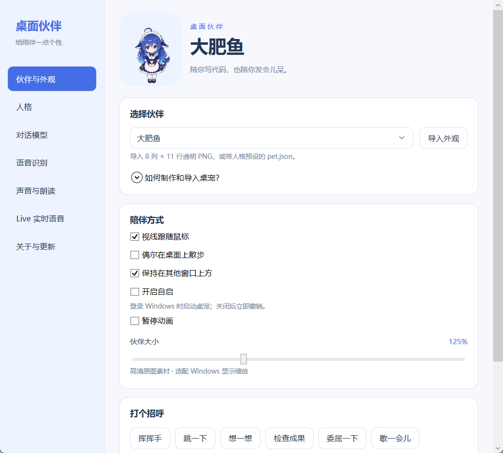

# 大肥鱼 · Windows 桌面伙伴

**v1.2**：高清、免安装的 Windows 桌宠，内置「大肥鱼」和「E包」，支持独立人格、头顶快速对话、文字与语音及 Gemini Live。作者：**彧晟Eason**。解压运行包，双击 **大肥鱼桌宠.exe**。适用于安装了 .NET Framework 4.8 的 Windows 10/11；普通用户运行即可。



## 怎么玩

- 左键拖动角色；单击挥手，**双击打开头顶快速对话**。跳跃在右键动作菜单。
- 右键打开对话、动作菜单、设置、隐藏或退出；系统托盘也可打开对话。
- 设置中切换「大肥鱼 / E包」，调节大小、鼠标视线、置顶和散步；改动立即生效并保存。
- 托盘的 **显示 / 隐藏伙伴** 为一个开关，勾选表示当前显示；找不到位置时选「回到屏幕角落」。
- 再次运行 EXE 会打开已有实例的设置窗口。

两套外观各含 73 帧、九组动作及十六个视线方向，每帧 **480×520**。素材直接从原始生成图重新抠图、处理边色和注册动作；完整图为 3840×5720。默认大小 125%，显示缩放由 Windows 处理。

## 导入新外观

设置 → **伙伴与外观** → **导入外观**，选择透明 PNG 精灵图，或与 PNG 同文件夹的 `pet.json`。展开“如何制作和导入桌宠”可打开 [模板文件夹](templates) 和 [完整教程](docs/skin-format.md)。ZIP 外观包需先解压。模板的 `system_prompt` 指定人格；只有 PNG 时自动生成基础人格，之后可在“人格”页修改。

位置、外观和选项保存在程序旁的 `data/settings.json`；首次退出或修改设置时创建。将整个文件夹放在可写的位置；保留 `data` 可保留个人设置。

## 开始文字与语音对话

右键 → **打开完整对话** → **连接设置**，选择服务预设或填写自己的地址、模型名称与密钥，点 **保存服务设置**。支持 **OpenAI Chat Completions / Anthropic Messages**，以及每项服务独立的本机代理开关（127.0.0.1:7890）。预设包含 OpenAI、Gemini、DeepSeek、MiMo、火山、Kimi、MiniMax、智谱、千问与 Claude；模型可自行修改。


- Enter 发送，Shift + Enter 换行；支持停止和清空会话。
- 语音采用 **点击说话 → 结束并发送 → 识别 → 模型回复 → 朗读**，每次最长 60 秒。
- MiMo ASR/TTS 使用正确的对话音频协议，分别支持地址/密钥复用。MiMo 音色如“苏打”。
- 也可在聊天框选择 **Live 实时语音 → 开始 Live**，使用独立的 Gemini Live 服务，支持持续对话、字幕和打断；再次点击结束并关闭麦克风。
- 双击角色在头顶气泡直接输入；“展开聊天”查看完整记录。气泡跟随角色并限制在屏幕内；关闭气泡后，本次请求继续完成。
- 默认使用 Windows 系统语音，也可以选独立的兼容合成服务及音色。
- 音量默认 50%，立即调节并保存；可关闭自动朗读。朗读失败仍保留文字回复。
- 密钥在设置里输入，以当前 Windows 用户加密保存；启动时不联网或录音。

详细地址格式、接口要求及故障处理见 [对话配置说明](docs/dialogue-setup.md)。每位伙伴最近 **10 轮**成功会话保存在内存，关闭聊天窗口可继续，退出程序后不保留。切换伙伴时同时切换人格与记录；进行中的对话需先停止。人格页可修改当前伙伴或恢复模板预设，保存后清空当前伙伴上下文。

## 关于与更新

设置 → **关于与更新** 显示作者、版本与 GitHub 地址。当前仓库使用 `https://github.com/OWNER/REPO` 占位，尚未建立或上传。将来填入实际公开仓库地址并发布正式 Release，即可检查版本和下载附件。优先下载 EXE/MSI 安装包，兼容 ZIP。支持进度、取消、完整性检查；如 GitHub 提供 SHA256 则验证。下载到 `data/downloads`，打开文件夹后手动运行安装包或解压，先退出旧版桌宠。当前交付仍为免安装版。

本机模拟接口、真实默认麦克风和 Windows 朗读已验证。未使用真实密钥请求在线模型，在线服务的兼容性和声音质量需配置后确认。

## 源码与构建

源码包已包含高清素材。在 Windows PowerShell 中进入源码目录运行：

```powershell
powershell -NoProfile -ExecutionPolicy Bypass -File .\Build.ps1 -Target App
```

使用 Windows 的 .NET Framework 4.8 C# 编译器、WPF 和托盘组件；编译结果位于同级 `outputs/DafeiyuDeskPet`。运行包可独立运行。`PrepareAssets.py` 是本次原图的可选导出脚本，使用 Pillow 和本机已有的抠图工具。

```powershell
powershell -NoProfile -ExecutionPolicy Bypass -File .\Build.ps1 -Target CoreTests
powershell -NoProfile -ExecutionPolicy Bypass -File .\Build.ps1 -Target ApiTests
powershell -NoProfile -ExecutionPolicy Bypass -File .\Build.ps1 -Target ConversationTests
powershell -NoProfile -ExecutionPolicy Bypass -File .\Build.ps1 -Target ProfileTests
powershell -NoProfile -ExecutionPolicy Bypass -File .\Build.ps1 -Target LiveTests
powershell -NoProfile -ExecutionPolicy Bypass -File .\Build.ps1 -Target UpdateTests
powershell -NoProfile -ExecutionPolicy Bypass -File .\Build.ps1 -Target ChatSmoke
powershell -NoProfile -ExecutionPolicy Bypass -File .\Build.ps1 -Target AudioSmoke
powershell -NoProfile -ExecutionPolicy Bypass -File .\Build.ps1 -Target UiSmoke
python .\tests\NativeSmoke.py
```

验证证据和适用范围见 [验证记录](docs/verification.md)，来源见 [素材与平台说明](docs/sources.md)。
